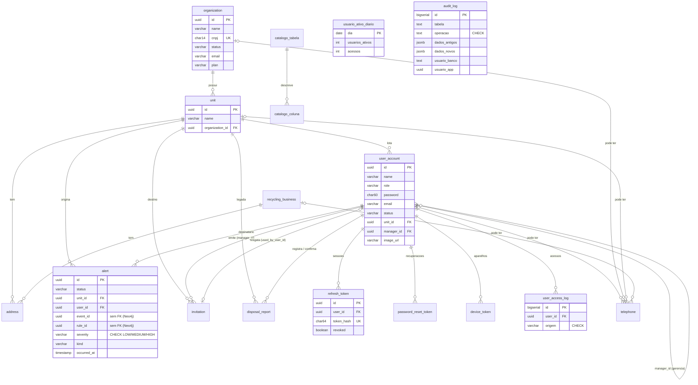

# Modelagem de dados — ms-administrative-core (PostgreSQL)

Documento unico de **entrega da disciplina Modelagem de Dados**. Ele centraliza o que foi feito,
aponta para os documentos detalhados em `docs/` e registra **o porque de cada escolha**.

## Sumario

1. [Mapa requisito → onde esta](#1-mapa-requisito--onde-esta)
2. [Modelo relacional](#2-modelo-relacional)
3. [Normalizacao (1FN a 3FN)](#3-normalizacao-1fn-a-3fn)
4. [Massa de dados](#4-massa-de-dados)
5. [Engenharia de dados: integracao com o legado](#5-engenharia-de-dados-integracao-com-o-legado)
6. [Camada de BI (Data Mart)](#6-camada-de-bi-data-mart)
7. [Objetos logicos: functions, procedures e triggers](#7-objetos-logicos-functions-procedures-e-triggers)
8. [Otimizacao](#8-otimizacao)
9. [Governanca, seguranca, monitoramento e estruturas avancadas](#9-governanca-seguranca-monitoramento-e-estruturas-avancadas)
10. [Como verificar](#10-como-verificar)

---

## 1. Mapa requisito → onde esta

Requisitos do PDF *Solicitacoes por Disciplina* (14/05/2026), disciplina **Modelagem de Dados**.

### Minimo para o 7,0

| Requisito | Onde | Secao |
| --- | --- | --- |
| Novo banco relacional PostgreSQL normalizado (3FN) | migracoes `V1`–`V25` | [3](#3-normalizacao-1fn-a-3fn) |
| PKs, FKs e cardinalidades definidas | DER e tabela de FKs | [2](#2-modelo-relacional) |
| Carga inicial de 500+ registros para teste de volume | `scripts/seed_qa.sql`, `scripts/seed_bench.sql` | [4](#4-massa-de-dados) |
| Integracao automatizada (RPA) entre banco legado e banco normalizado, com integridade e tratamento de falhas | `infrastructure/legacysync/`, `docs/legacy-db-field-mapping.md` | [5](#5-engenharia-de-dados-integracao-com-o-legado) |
| Views analiticas de BI com modelagem dimensional (Star/Snowflake) | `V15`, `docs/modelagem-dimensional.md` | [6](#6-camada-de-bi-data-mart) |
| CTEs na transformacao | views `bi.*`, `V13`, `V14`, `V18` | [6](#6-camada-de-bi-data-mart) |
| Window functions (running total, ranking) | `bi.vw_alertas_mensal_unidade`, `vw_ranking_unidades`, `vw_dau_diario` | [6](#6-camada-de-bi-data-mart) |
| 2 functions e 2 procedures de regra de negocio | `V13` (3 functions), `V14` (3 procedures) | [7](#7-objetos-logicos-functions-procedures-e-triggers) |
| Triggers de auditoria (NEW, OLD, TG_OP, CURRENT_USER) em 2+ tabelas | `V11` (3 tabelas) | [7](#7-objetos-logicos-functions-procedures-e-triggers) |
| EXPLAIN ANALYZE e indices | `V16`, `V20`, `docs/otimizacao.md` | [8](#8-otimizacao) |

### Extra

| Requisito | Onde | Secao |
| --- | --- | --- |
| Catalogo de dados (tabelas, colunas, regras, niveis de acesso) | `V18`, `V22`, `V24`, `docs/catalogo-dados.md` | [9.1](#91-catalogo-de-dados-e-niveis-de-acesso) |
| Backup e recuperacao documentados | `docs/backup-recuperacao.md`, `scripts/backup.sh` | [9.2](#92-backup-e-recuperacao) |
| DAU automatizado no Postgres | `V12` | [9.3](#93-monitoramento-dau) |
| CTE recursiva e heranca de tabelas | `V13`, `V15`, `V11` | [9.4](#94-estruturas-avancadas) |

---

## 2. Modelo relacional

### 2.1 DER

Reflete o schema **real**, isto e, o resultado da aplicacao de `V1`–`V25`. `disposal_report` esta marcada como legada na secao 2.4.



Tabelas sem relacionamento no diagrama, por serem infraestrutura: `audit_log` (+ filhas
`audit_log_user_account`, `audit_log_alert`, `audit_log_organization`, ver 9.4), `job_execucao`,
`usuario_ativo_diario` (rollup derivado) e `catalogo_*`. A auditoria **nao tem FK para a tabela
auditada** de proposito: auditoria precisa sobreviver ao `DELETE` da linha que ela registra.

### 2.2 Chaves estrangeiras e cardinalidades

Todas as FKs abaixo existem como `CONSTRAINT ... FOREIGN KEY` nas migracoes. Sem `ON DELETE`
explicito significa `NO ACTION` (o `DELETE` do pai e **recusado** se houver filho).

| Filha (coluna) | Pai | Cardinalidade | `ON DELETE` | Obrigatoria? | Migracao |
| --- | --- | --- | --- | --- | --- |
| `unit.organization_id` | `organization` | N:1 | — | sim | V1 |
| `user_account.unit_id` | `unit` | N:1 | — | sim | V1 |
| `user_account.manager_id` | `user_account` | N:1 (auto) | — | nao (so `EMPLOYEE`) | V4 |
| `address.unit_id` | `unit` | N:1 | — | exatamente uma das duas* | V1 |
| `address.recycling_business_id` | `recycling_business` | N:1 | — | exatamente uma das duas* | V1 |
| `telephone.user_id` / `organization_id` / `unit_id` / `recycling_business_id` | respectivos | N:1 cada | — | uma delas* | V1 |
| `alert.unit_id` | `unit` | N:1 | — | sim | V1 |
| `alert.user_id` | `user_account` | N:1 | — | sim | V3 |
| `invitation.manager_id` | `user_account` | N:1 | — | sim | V6 |
| `invitation.unit_id` | `unit` | N:1 | — | sim | V6 |
| `invitation.used_by_user_id` | `user_account` | N:1 (na pratica 1:1)** | — | nao | V6 |
| `refresh_token.user_id` | `user_account` | N:1 | — | sim | V7 |
| `password_reset_token.user_id` | `user_account` | N:1 | — | sim | V23 |
| `device_token.user_id` | `user_account` | N:1 | **CASCADE** | sim | V21 |
| `user_access_log.user_id` | `user_account` | N:1 | — | sim | V12 |
| `disposal_report.user_id` / `unit_id` / `confirmed_by` | `user_account` / `unit` / `user_account` | N:1 | — | `confirmed_by` nao | V1 |
| `catalogo_coluna.tabela` | `catalogo_tabela` | N:1 | **CASCADE** | sim | V18 |

\* `address` e `telephone` pertencem a **um dono por linha**, entre varios possiveis (cada coluna e uma
FK real). A regra "um dono por linha" e do dominio e esta registrada na `regra_negocio` do catalogo.
Alternativas consideradas em 2.3.

\*\* `used_by_user_id` e N:1 por constraint e **1:1 por regra**: um convite e resgatado por um
usuario.

**Cardinalidades do modelo.**

| Tipo | Onde |
| --- | --- |
| **1:N** | organizacao → unidade → usuario/endereco/alerta/convite; usuario → sessao/acesso/recuperacao de senha/device; recicladora → endereco/telefone |
| **1:N recursivo** (auto-relacionamento) | `user_account.manager_id` — gestor → equipe, com profundidade variavel |
| **1:1 por regra** | convite ↔ usuario que o resgatou (`used_by_user_id`) |
| **N:N** | a relacao N:N do dominio (item fisico × modelo × material) e modelada como **aresta no grafo Neo4j** do `ms-inventory`, onde e o desenho natural; no relacional o Postgres guarda so os identificadores dessas entidades (`alert.event_id`, `alert.rule_id`) |

### 2.3 Escolhas de modelagem e o porque

| Escolha | Alternativa descartada | Por que |
| --- | --- | --- |
| **PK `UUID`** em todas as tabelas de dominio | `BIGSERIAL` | Os ids viajam em JWT (`sub`), em contratos entre servicos e no legado; um id sequencial vazaria volume e permitiria enumeracao. |
| **`BIGSERIAL`** so em tabelas de log (`audit_log`, `user_access_log`, `job_execucao`) | UUID | Sao append-only, nunca expostas por API, e a ordem monotonica ajuda na leitura por intervalo. |
| `user_account` e nao `user` | `user` | `user` e palavra reservada no Postgres. |
| **Herdar `MANAGER` e `EMPLOYEE` na mesma tabela** (`role` discriminador) | duas tabelas | Compartilham 95% das colunas e ambos autenticam; duas tabelas obrigariam `UNION` em login, auditoria e BI. `manager_id` so e preenchido para `EMPLOYEE`. |
| `cnpj CHAR(14)`, `cep CHAR(8)`, `password CHAR(60)`, `token_hash CHAR(64)` | `VARCHAR` | Tamanho **fixo por definicao** (CNPJ sem mascara, hash bcrypt, SHA-256 hex). `CHAR` documenta e rejeita lixo. |
| Guardar so o **hash** de tokens (`refresh_token`, `password_reset_token`) | guardar o token | Vazamento do banco nao entrega sessao nem recuperacao de senha validas. |
| `TIMESTAMP(0) WITHOUT TIME ZONE` | `timestamptz` | O dominio opera em horario local unico e o ORM trabalha com `LocalDateTime`; precisao de segundo basta e economiza espaco. Mistura de fusos num legado `timestamptz` e tratada na conversao do sync. |
| `telephone` e `address` com **FKs anulaveis, uma por dono** | (a) tabela-pai `contato` com subtipos; (b) tabelas `*_telephone` por dono; (c) `owner_type`+`owner_id` | (c) perde FK. (a)/(b) dao integridade total mas multiplicam tabelas e joins para um dado de cadastro simples. A escolha mantem FK real em cada dono, e a regra de "um dono por linha" fica no dominio. |
| `alert.event_id` / `rule_id` **sem FK** | FK | Apontam para o Neo4j. |
| `device_token.token` **UNIQUE** (e nao `(user_id, token)`) | UNIQUE composto | O token FCM identifica o **aparelho**; reinstalar o app ou trocar de conta pode reemitir o mesmo token. Com UNIQUE no token, o registro so move o dono em vez de duplicar a linha e mandar push para a pessoa errada. |
| **Indice unico parcial** em vez de `UNIQUE` simples (`invitation.code` `WHERE status='PENDING'`; `recycling_business.place_id` `WHERE NOT NULL`; `alert (rule_id,event_id,user_id)` `WHERE status='OPEN'`) | `UNIQUE` | A unicidade vale so num subconjunto: codigo de convite pode ser reaproveitado apos usado; parceira sem ponto no mapa e valida; reabrir o mesmo evento depois de fechado e legitimo. |
| `CHECK (fn_validar_cnpj(cnpj)) NOT VALID` em `organization` (V19) | `CHECK` normal | `NOT VALID` nao reescaneia o legado (um CNPJ sujo derrubaria o deploy) mas vale para toda escrita nova. Pode ser validado depois sem bloquear escrita. |

### 2.4 `disposal_report` — tabela legada

Criada na `V1` para o relatorio de descarte. O catalogo a classifica como `origem = 'LEGADO'`: o
fluxo de descarte vive hoje no `ms-inventory`, e manter a tabela preserva o historico do modelo,
ja que descarta-la e uma decisao de produto (feita por migracao nova, nunca editando a `V1`).

---

## 3. Normalizacao (1FN a 3FN)

### 3.1 Resultado

| Forma | Aplicacao | Observacao |
| --- | --- | --- |
| **1FN** (valores atomicos, sem grupos repetidos) | aplicada | Nenhuma coluna multivalorada. Telefone e endereco sao tabelas proprias (nao `telefone1, telefone2`). `audit_log.dados_*` e `JSONB`, mas e **payload de auditoria**, nao dado de dominio consultado por atributo. |
| **2FN** (sem dependencia parcial da PK) | aplicada | Todas as PKs de dominio sao simples (um `UUID`). A unica PK composta e `catalogo_coluna (tabela, coluna)`, e os demais atributos dependem do par inteiro. |
| **3FN** (sem dependencia transitiva) | aplicada | Dados de dominio em 3FN; `address` (3.2) e o rollup `usuario_ativo_diario` (3.4) sao decisoes de projeto documentadas. |
| 5FN | nao necessaria | Nao ha relacao ternaria que decomponha com perda; as relacoes sao binarias. |

### 3.2 Decisao de projeto: `address` como dado de cadastro

`address` guarda cidade, UF e bairro junto do CEP, como o usuario os informa. Isso foi mantido
porque normalizar exigiria uma tabela de referencia de CEPs que (a) dependeria da base dos Correios,
(b) nao e confiavel para bairro (CEP de cidade pequena e unico para a cidade toda; CEP de rua longa
cruza bairros) e (c) a aplicacao recebe o endereco ja digitado, nao consulta CEP. E **dado de
cadastro digitado**, nao dado de referencia.

### 3.3 Decisao de projeto: `organization.plan` como coluna, nao tabela

A modelagem inicial tinha `plan (id, name, price, description)`. A `V2` o removeu. Razao: o legado
(banco do primeiro ano) tem `plano` e `assinatura`, e o novo banco **so precisa saber qual plano a
organizacao tem** — nome, preco e descricao nao sao lidos por nenhum caso de uso, e o preco real
vive no sistema de cobranca. Sem atributos proprios, a tabela `plan` virou so um dominio de valores,
que o `Plan` (enum no dominio) ja representa. Os valores validos hoje sao os do enum `Plan`
(`FREE`, `PROFISSIONAL`, `EMPRESARIAL`), que e o que o sync do legado mapeia.

### 3.4 Redundancia controlada: `usuario_ativo_diario`

E um **rollup derivado** de `user_access_log` (a fonte da verdade). Duplica informacao de proposito:
DAU e consulta de dashboard, e `COUNT(DISTINCT)` sobre milhoes de linhas a cada abertura de tela nao
se sustenta. E **reconstruivel a qualquer momento** por `sp_consolidar_dau`. O catalogo a marca
`origem = 'DERIVADO'`, para ninguem trata-la como fonte.

### 3.5 Demais pontos que parecem violacao e nao sao

| Aparente problema | Por que nao e |
| --- | --- |
| `user_account.manager_id` so vale para `EMPLOYEE` | E dependencia **condicional** de `role`, nao funcional entre atributos nao-chave: `role` nao determina `manager_id`. Fica `NULL` para `MANAGER`. |
| `alert.kind` e `severity` como texto | Sao atributos do alerta, nao entidades com atributos proprios. `severity` tem `CHECK`. |
| `status` como `VARCHAR` em varias tabelas | Dominios fechados e pequenos; tabela de dominio para cada um seria mais joins que informacao. |
| `catalogo_*` descrevendo as tabelas | Metadado, nao dado de negocio. |

---

## 4. Massa de dados

| Script | Quando roda | Volume | Uso |
| --- | --- | --- | --- |
| `scripts/seed_qa.sql` | todo deploy em QA (idempotente) | ~5 mil linhas no total, das quais ~1,5 mil contas de usuario e ~1,4 mil acessos | dado parecido com producao em QA |
| `scripts/seed_bench.sql` | manual | centenas de milhares de linhas (~120 mil alertas, ~20,7 mil usuarios, ~241 mil de auditoria) | medir plano de consulta |

**Por que `seed_bench` existe:** com 50 linhas o planner escolhe `Seq Scan` para tudo, porque ler a
tabela inteira custa menos que abrir um indice. Medir otimizacao em banco vazio nao mede nada.

**Decisoes de desenho dos seeds:**

- **CNPJs com digitos verificadores validos** (`11222333000181`, `11444777000161`): a `V19` aplica
  `fn_validar_cnpj` como `CHECK`; um CNPJ inventado derrubaria a carga.
- **Idempotente em QA:** o script sai se a organizacao `Organizacao QA 1` ja existe, para nao
  duplicar volume a cada push.
- **Acessos inseridos via `refresh_token`, nao direto em `user_access_log`:** exercita o trigger de
  DAU (V12) de verdade.
- **Hierarquia de tres niveis** (gestor → coordenador → funcionario) para a CTE recursiva ter o
  que percorrer.
- **Alertas assimetricos por unidade** (distribuicao por `hashtext` do id da unidade): sem
  assimetria o ranking de BI nao tem o que ranquear.

**Como usar:** apos aplicar as migracoes, `psql -f scripts/seed_qa.sql` popula o banco (comandos na
secao 10). Os dados cobrem toda a hierarquia — organizacao, unidade, gestor, coordenador,
funcionario, alerta, sessao e acesso — e disparam os triggers de auditoria e de DAU.

---

## 5. Engenharia de dados: integracao com o legado

### 5.1 Integracao automatizada (RPA de dados)

> *"Orquestrar a movimentacao de dados entre o banco legado e o novo banco normalizado via RPA,
> garantindo a integridade e tratando falhas na carga."*

A movimentacao e feita por um **robo de integracao agendado** (`infrastructure/legacysync/`,
`@Scheduled`) que le o banco PostgreSQL do primeiro ano e grava no banco normalizado a cada
intervalo configuravel. Como os dois bancos sao Postgres acessiveis por JDBC, o robo le as
**tabelas** diretamente — mais rapido e mais robusto que automatizar a interface de um sistema.

### 5.2 DE/PARA

Detalhe completo em [legacy-db-field-mapping.md](legacy-db-field-mapping.md). Resumo:

| Legado | Novo | Observacao |
| --- | --- | --- |
| `gestor` | `user_account` (`role=MANAGER`, `status=ACTIVE`) + `telephone` | telefone vai para tabela propria (normalizacao) |
| `unidade` | `unit` | importa nome e organizacao; CNPJ e e-mail da unidade permanecem no legado |
| `organizacao` + `assinatura` + `plano` | `organization` | `plano` e `status` vem da **assinatura mais recente** |

### 5.3 Integridade e tratamento de falhas

| Garantia | Como |
| --- | --- |
| Ordem pai → filho | `organizacao` → `unidade` → `gestor`; linha cujo pai nao foi sincronizado e **ignorada** (nao quebra a FK) |
| Linha invalida nao derruba a rodada | cada linha roda isolada (`run(...)`): CNPJ/e-mail invalido, hash que nao e bcrypt, plano desconhecido → `skipped` + log com tipo e codigo |
| Relatorio por rodada | `SyncReport(saved, skipped, pushed)` logado com a duracao |
| Legado fora do ar | `CannotGetJdbcConnectionException` tratada: loga a causa raiz numa linha (nao 40 de stack) e tenta de novo no proximo intervalo |
| Varias replicas | `pg_try_advisory_xact_lock` — um pod por rodada; lock **de transacao** (nao de sessao) para nao ficar preso com o pool do Hikari |
| Edicao local nao e desfeita | compara `updated_at` local com `gestor.atualizado_em` **por registro**; quem editou por ultimo vence |
| Escrita de volta no legado | `UPDATE ... WHERE codigo=? AND atualizado_em=<lido>` (otimista): se o legado mudou entre leitura e escrita, nao grava e o legado vence na rodada seguinte |
| Idempotencia | a rodada recalcula tudo; rodar duas vezes seguidas nao muda mais nada |
| Desligado por padrao | `legacy-sync.enabled=false` — ligar integracao nunca e pre-requisito para o servico subir |

### 5.4 Regras de escopo da integracao

- A comparacao de edicao e **por registro**: quem editou por ultimo vence o registro inteiro.
- O legado e a fonte da verdade de `organizacao` e `unidade`; a protecao de edicao local vale para
  o gestor (nome, e-mail, senha, telefone).
- Com um unico legado para QA e producao, **um ambiente por vez** liga o sync, porque a escrita de
  volta vai para a mesma fonte.
- O contrato esperado do legado (assinatura vigente, plano, formato de senha) esta em
  `legacy-db-field-mapping.md`.

---

## 6. Camada de BI (Data Mart)

Schema `bi`, criado na `V15`. Detalhe e diagrama em
[modelagem-dimensional.md](modelagem-dimensional.md).

```
dim_organizacao ◄── dim_unidade ◄──┐
                                   ├── fato_alerta   (grao: 1 alerta)
dim_tempo ◄────────────────────────┤
dim_usuario ◄──────────────────────┴── fato_acesso   (grao: 1 evento de autenticacao)
```

| Escolha | Porque |
| --- | --- |
| **Snowflake**, nao Star puro | `dim_unidade` aponta para `dim_organizacao` em vez de repetir plano/status em cada unidade. A hierarquia ja existe no OLTP; desnormalizar criaria duas fontes para o mesmo atributo. |
| **Views**, nao materialized views | Volume pequeno e dado precisa estar atualizado no segundo. Materializar exige refresh e cria um lugar novo para falhar em silencio. Caminho de crescimento: trocar para `MATERIALIZED VIEW` + `REFRESH` em `sp_consolidar_dau`, **sem mudar a interface de consulta**. |
| **Schema separado** + role `zera_bi_leitor` | Uma view executa com os privilegios de quem a criou; a ferramenta de BI le `bi.*` sem ter acesso a `alert` nem a `user_account` (hash de senha). Verificado por teste de integracao. |
| `dim_organizacao` **sem CNPJ e e-mail** | Dado pessoal/sensivel que nenhum grafico agrupa. |
| `dim_tempo` contem **todo dia**, inclusive sem fato | Para "zero acessos na terca" aparecer. Sem isso, uma queda a zero fica invisivel. O inicio do calendario e **dirigido pelo dado** (`MIN(occurred_at)`), nao constante: com data fixa, alertas anteriores sumiam silenciosamente da view mensal (coberto por teste de integracao). |
| `dim_unidade` com `DISTINCT ON` no endereco | `address.unit_id` nao e unico; sem isso a unidade duplica e todo fato e contado em dobro (fan-out de join). |
| `peso_severidade` HIGH=9, MEDIUM=3, LOW=1 | 10 alertas LOW nao equivalem a 10 HIGH. Escala igual a de `fn_indice_saude_unidade` e a do `ms-inventory` — **mudar em um lugar sem os outros faz o painel discordar do alerta**. |

**CTEs e window functions (requisito explicito):**

| View | CTE | Window functions |
| --- | --- | --- |
| `bi.vw_alertas_mensal_unidade` | `base` → `janelas` | `SUM() OVER` (running total), `DENSE_RANK`, `AVG() OVER ... 2 PRECEDING` (media movel), `LAG` |
| `bi.vw_dau_diario` | calendario + agregados | media movel 7d, acumulado, variacao dia a dia, `LEFT JOIN LATERAL` para unicos em 7d |
| `bi.vw_ranking_unidades` | `periodo` → `ativos_por_unidade` → `com_usuarios` | `RANK`, `DENSE_RANK`, `NTILE(4)`, `PERCENT_RANK`, participacao percentual |
| `bi.vw_hierarquia_equipe` | **CTE recursiva** | — |

`usuarios_unicos_7d` usa `LATERAL` e nao window function porque `COUNT(DISTINCT)` **nao e suportado
como funcao de janela** no Postgres — limitacao do banco, nao estilo.

---

## 7. Objetos logicos: functions, procedures e triggers

**Criterio para uma regra morar no banco** (e nao no dominio Java): ela precisa ser respondida em
**conjunto** (varias linhas, relatorio, BI), ser **recursiva sobre hierarquia**, ou validar dado que
**entra sem passar pelo dominio** (o sync do legado grava direto). Regra que decide o destino de
*uma* entidade fica no dominio, onde da para testar sem banco.

### 7.1 Functions (`V13`)

| Function | O que faz | Por que no banco |
| --- | --- | --- |
| `fn_validar_cnpj(text)` | digitos verificadores (modulo 11); rejeita todos-iguais | `IMMUTABLE`, usada como `CHECK` em `organization` (V19). O legado grava sem passar pelo dominio. |
| `fn_tamanho_equipe(uuid)` | conta a subarvore **inteira** de subordinados (CTE recursiva) | um `COUNT` simples contaria so os diretos — pergunta errada. Protegida contra ciclo por um array de caminho acumulado. |
| `fn_indice_saude_unidade(uuid, date, date)` | indice 0–100 por severidade, normalizado por usuario ativo, **escala logaritmica** | volume de alerta tem cauda longa; em escala linear todas as unidades ruins saturavam em 0,00 (verificado na carga de bench). |

### 7.2 Procedures (`V14`)

Todas **idempotentes** e todas registram em `job_execucao`.

| Procedure | O que faz | Observacao |
| --- | --- | --- |
| `sp_fechar_alertas_obsoletos(dias, INOUT afetados)` | fecha alertas `OPEN` antigos (por `occurred_at`) | Acionada sob demanda por rota interna; o agendamento e opt-in, porque fechar alerta e decisao de produto e o `ms-inventory` observa o status. |
| `sp_revogar_tokens_expirados(retencao, INOUT revogados, INOUT removidos)` | revoga e depois expurga `refresh_token` | dois passos separados: revogar e barato e invalida na hora; remover apaga prova, entao fica a janela de retencao. |
| `sp_consolidar_dau(de, ate, INOUT dias)` | reconstroi o rollup a partir do log | rede de seguranca do trigger de DAU. |

**PROCEDURE e nao FUNCTION** porque escrevem e porque o volume escrito e imprevisivel: procedure
pode controlar transacao.

**Onde sao acionadas (nao ficam so no banco):** portas `MaintenanceRepository`,
`AnalyticsRepository` e `DataCatalogRepository` (adaptadores com `JdbcTemplate`), endpoints
`/api/v1/analytics/*` e `POST /maintenance/*`, e agendador opcional (`MAINTENANCE_ENABLED`,
desligado). O acionamento usa `CALL` nativo via `queryForObject`, que devolve os
parametros `INOUT` como linha de resultado.

### 7.3 Triggers de auditoria (`V11`)

`fn_auditoria()` em `AFTER INSERT OR UPDATE OR DELETE ... FOR EACH ROW` sobre **`user_account`,
`alert` e `organization`** (pede-se 2). Grava `TG_OP`, `OLD`/`NEW` como `JSONB`, `CURRENT_USER`,
usuario da aplicacao e timestamp.

| Decisao | Porque |
| --- | --- |
| `usuario_banco` (`CURRENT_USER`) **e** `usuario_app` sao colunas distintas | A aplicacao usa **um** usuario no pool: `CURRENT_USER` responde "qual conexao", nunca "qual pessoa". A pessoa vem do `sub` do JWT e chega via `SET LOCAL zera.app_user` **na mesma transacao** (por isso os adaptadores que escrevem em tabela auditada sao `@Transactional`). Uma coluna serve forense de infra, a outra de produto. |
| **Mascaramento** (`fn_mascarar_sensiveis`) remove `password`, `token_hash`, `code` | `to_jsonb(NEW)` copia a linha inteira, inclusive o hash bcrypt. Auditoria que guarda hash de senha e "vazamento com nome bonito". |
| `SECURITY DEFINER` com `search_path = pg_catalog, public, pg_temp` | Sem search_path fixo, e escalada de privilegio conhecida. **O ataque foi reproduzido neste schema**: uma role comum cria `TEMP TABLE audit_log_user_account` e a linha de auditoria vai para a tabela do atacante. `pg_temp` precisa estar listado **e por ultimo** — sem listar, o Postgres o pesquisa *primeiro*. |
| Trigger de `TRUNCATE` (`STATEMENT`) | Trigger `FOR EACH ROW` **nao dispara em TRUNCATE**: sem ele, `TRUNCATE alert` apagaria tudo sem uma linha de trilha. Registra o comando e a conexao que o executou. |
| `uuid` invalido em `zera.app_user` nao derruba a escrita | Auditar nao pode impedir a escrita que esta sendo auditada: grava sem o usuario de aplicacao. |
| Sem filha dedicada, grava no pai | O registro de auditoria e sempre gravado, mesmo para uma tabela nova ainda sem filha. |

---

## 8. Otimizacao

Metodo e planos completos em [otimizacao.md](otimizacao.md). Medido com
`EXPLAIN (ANALYZE, BUFFERS)` em Postgres 16 sobre `seed_bench.sql`; o "antes" foi obtido
**revertendo a V16 sobre a mesma carga**, para a comparacao medir otimizacao e nao volume.

| # | Consulta | Antes | Depois | Mecanismo |
| --- | --- | --- | --- | --- |
| Q1 | Alertas do usuario, paginado | 1,786 ms | 0,159 ms (**11x**) | indice composto `(user_id, status, created_at DESC)`: elimina heap filter e `Sort` |
| Q2 | Gestores da unidade (contrato com o inventory) | 4,978 ms | 0,187 ms (**27x**) | `(unit_id, role)` — Seq Scan descartava 20.658 de 20.680 linhas |
| Q3 | View mensal de BI | 165,8 ms | 163,0 ms | plano ja otimo: a view agrega quase todos os alertas, e varrer a tabela e o caminho mais barato |
| Q4 | Ranking de unidades (90 d) | 980,1 ms | 33,2 ms (**30x**) | reescrita: subconsulta correlacionada (rodava por unidade) virou `LEFT JOIN` agregado; filtro por `occurred_at` em vez do cast `data_id` (cast escondido inutilizava o indice) |
| Q5 | Auditoria recente de uma tabela | 48,9 ms | 0,103 ms (**475x**) | `CHECK (tabela = ...)` nas filhas habilita `constraint_exclusion`; indice por data |
| Q6 | `MIN(occurred_at)` do calendario | 20,9 ms | 0,88 ms (**~24x**) | `idx_alert_occurred_at` (V20) |

**Indices removidos** (`idx_alert_user_id`, `idx_alert_unit_id`): viraram **prefixo exato** dos
compostos novos; mante-los custaria uma escrita a mais por alerta (que chega em rajada) sem ganho.

Nem toda otimizacao e indice: em Q3 o plano ja e o melhor possivel e em Q4 o ganho veio de
reescrever a consulta.

---

## 9. Governanca, seguranca, monitoramento e estruturas avancadas

### 9.1 Catalogo de dados e niveis de acesso

`catalogo_tabela` + `catalogo_coluna` (`V18`, atualizado em `V22` e `V24`). Detalhe em
[catalogo-dados.md](catalogo-dados.md).

**Por que uma tabela e nao um documento:** documento de schema apodrece em silencio. A tabela muda
no mesmo commit que o schema e pode ser **confrontada** com o `information_schema` por
`fn_catalogo_divergencia()`; o teste `DataCatalogIntegrationTest` **quebra o build** se alguem
adicionar coluna sem documentar.

| Nivel | Significado | Exemplos |
| --- | --- | --- |
| `INTERNO` | equipe | ids, timestamps |
| `RESTRITO` | equipe do dominio | `alert.*`, `user_access_log.*` |
| `CONFIDENCIAL` | dado pessoal | e-mail, endereco, telefone, CNPJ |
| `SECRETO` | credencial; nunca exportar | `password`, `token_hash`, `invitation.code` |

O nivel **e aplicado** pelas roles da `V17`: `zera_bi_leitor` (so `bi`, `NOLOGIN`) e `zera_auditor`
(so `audit_log*`, `job_execucao`). **Catalogo sem role e documentacao; role sem catalogo e permissao
sem explicacao.** As roles sao `NOLOGIN` de proposito: a conta real e criada pelo DBA e a senha
**nunca entra numa migracao versionada**.

**Escopo do acesso de BI:** `zera_bi_leitor` le apenas o schema `bi`, sem credencial, hash, CNPJ,
e-mail, telefone ou endereco. Nome de pessoa, de unidade e cidade fazem parte das dimensoes, entao a
ferramenta de BI opera dentro do perimetro da LGPD.

### 9.2 Backup e recuperacao

Runbook em [backup-recuperacao.md](backup-recuperacao.md); script em `scripts/backup.sh`.

| Metrica | Alvo |
| --- | --- |
| RPO | 24 h (backup logico) / 5 min (PITR) |
| RTO | 2 h |
| Retencao | 7 diarios, 4 semanais, 3 mensais |

Pontos de desenho: o script **verifica o dump na hora** (`pg_restore --list`), porque dump
corrompido que ninguem abriu e arquivo, nao backup; restaura **em banco novo e vazio**, nunca sobre
banco com dado; **valida antes de apontar a aplicacao**; e ha receita de backup **sem dado pessoal**
para homologacao (hash de senha e de token ficam fora).

### 9.3 Monitoramento (DAU)

`V12`. **Trigger `trg_registrar_acesso` em `refresh_token`**: toda sessao emitida (login ou
refresh) grava um evento em `user_access_log` e atualiza `usuario_ativo_diario`.

| Decisao | Porque |
| --- | --- |
| Trigger no banco, nao chamada no login | Nenhum caminho novo de autenticacao consegue emitir sessao sem gravar o token — logo nao consegue "esquecer" de contar. |
| Incremental (`ON CONFLICT DO UPDATE`), nao `COUNT(DISTINCT)` do dia | Recontar o dia a cada acesso e O(n²) no dia. |
| Origem `LOGIN`/`REFRESH` por `zera.access_origin` | Testes passam pelos beans reais de login e refresh, provando que a aplicacao publica a origem e que o trigger a le. |

**Trade-offs do desenho:** (1) acessos simultaneos do mesmo usuario no mesmo dia podem somar +1 no
contador (diferenca de metrica, nao de dado; `sp_consolidar_dau` reconcilia pelo log); (2) o
`ON CONFLICT` serializa os logins do dia numa unica linha, com secao critica curta e adequada ao
volume. Evolucao possivel: tirar o rollup do trigger e consolidar so pela procedure.

### 9.4 Estruturas avancadas

| Estrutura | Onde | Por que aqui |
| --- | --- | --- |
| **Heranca de tabelas** | `audit_log` (pai, **sempre vazio**) → `audit_log_user_account`, `audit_log_alert`, `audit_log_organization` | `SELECT FROM audit_log` ve tudo; cada filha tem indices proprios e pode ser truncada/arquivada sozinha. Sem isso a auditoria vira **uma tabela quente que cresce mais rapido que todo o resto do banco**. Filhas **nao herdam PK** (o Postgres nao propaga unicidade) mas compartilham a sequencia. |
| **CTE recursiva** | `fn_tamanho_equipe`, `bi.vw_hierarquia_equipe`, `bi.dim_tempo` | hierarquia de gestor tem profundidade **variavel**; impossivel em SQL nao recursivo. O array `caminho` corta ciclos. |

> **Nao confundir:** a heranca **single-table do JPA** (`user_account` com `role`) e mapeamento; a
> heranca de tabelas do Postgres (`audit_log`) e fisica. Sao coisas diferentes.

---

## 10. Como verificar

```bash
# 1. Postgres 16 limpo + app aplica V1..V25 no boot (Flyway)
./mvnw spring-boot:run

# 2. Suite que prova o que esta aqui (exige Docker; sem Docker ela e PULADA)
./mvnw verify
#   FlywayPostgresIntegrationTest   migracoes + objetos Postgres + roles
#   AuditTriggerIntegrationTest     trigger de auditoria, mascaramento, TRUNCATE
#   BiViewsIntegrationTest          views, fato x view, fan-out de endereco
#   DataCatalogIntegrationTest      catalogo x information_schema
#   BusinessFunctionsIntegrationTest / BusinessProceduresIntegrationTest / DauTriggerIntegrationTest

# 3. Massa de dados (apos as migracoes)
psql -U postgres -d zera -f scripts/seed_qa.sql      # ~5 mil linhas, idempotente
psql -U postgres -d zera -f scripts/seed_bench.sql   # carga de benchmark
psql -U postgres -d zera -c "ANALYZE;"                # obrigatorio antes de medir
```

```sql
-- Normalizacao / chaves: todas as FKs e cardinalidades
SELECT conrelid::regclass AS filha, a.attname AS coluna,
       confrelid::regclass AS pai, confdeltype AS on_delete
  FROM pg_constraint c
  JOIN pg_attribute a ON a.attrelid = c.conrelid AND a.attnum = ANY (c.conkey)
 WHERE c.contype = 'f' AND c.connamespace = 'public'::regnamespace
 ORDER BY 1, 2;

-- Volume da massa de dados
SELECT 'organization' t, count(*) FROM organization UNION ALL
SELECT 'unit', count(*) FROM unit UNION ALL
SELECT 'user_account', count(*) FROM user_account UNION ALL
SELECT 'alert', count(*) FROM alert UNION ALL
SELECT 'user_access_log', count(*) FROM user_access_log;

-- Catalogo sem divergencia (deve devolver zero linhas)
SELECT * FROM fn_catalogo_divergencia();

-- Heranca: o pai esta vazio, as filhas nao
SELECT tableoid::regclass, count(*) FROM audit_log GROUP BY 1;

-- Window functions e CTE recursiva em acao
SELECT * FROM bi.vw_ranking_unidades ORDER BY ranking_geral LIMIT 5;
SELECT * FROM bi.vw_hierarquia_equipe LIMIT 10;

-- Funcoes e procedures
SELECT fn_validar_cnpj('11222333000181');
CALL sp_consolidar_dau(CURRENT_DATE - 30, CURRENT_DATE, NULL);
```
